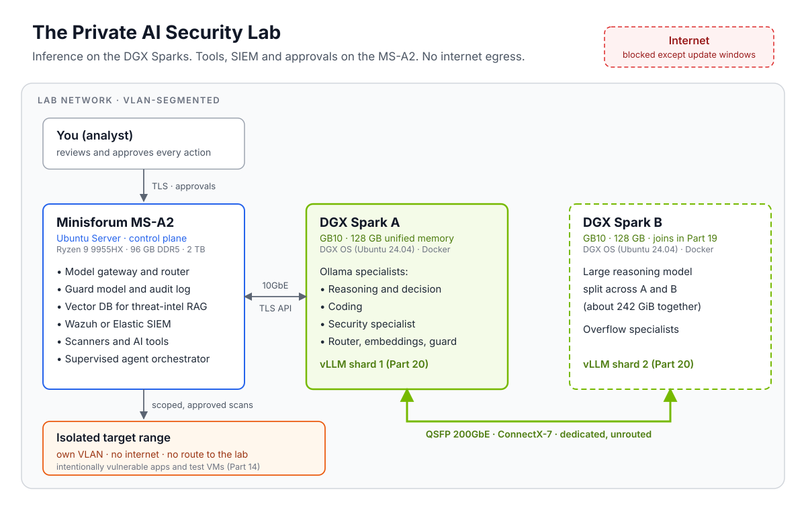

# Architecture

- **MS-A2 control plane** (Ubuntu Server 24.04): model gateway, guard model, audit log, vector DB,
  one SIEM at a time (Wazuh or Elastic), scanners, AI tools and the supervised agent.
- **DGX Spark A**: Ollama serving the specialist models. From Part 20 it also holds vLLM shard 1.
- **DGX Spark B** (Part 19+): vLLM shard 2, so one large reasoning model spans about 242 GiB.
- **Isolated target range**: its own VLAN with no internet and no route back into the lab.

Network rules are defined as code in `infra/` (Part 3).
